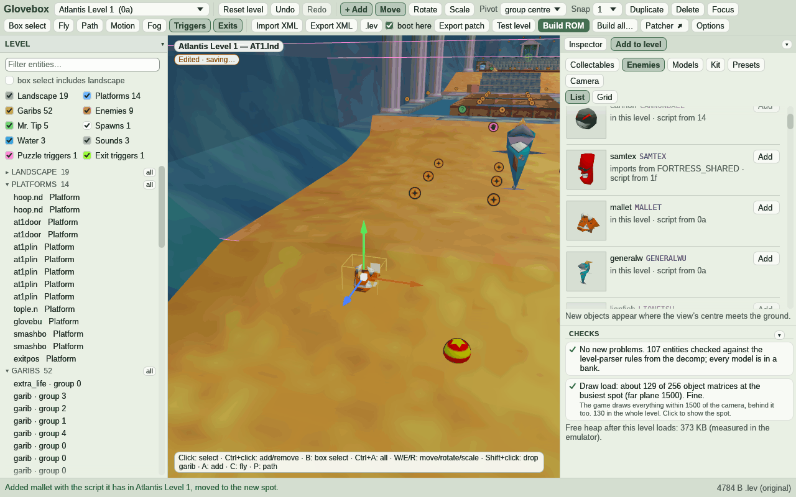
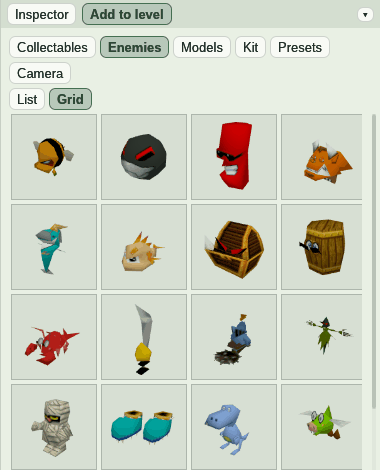
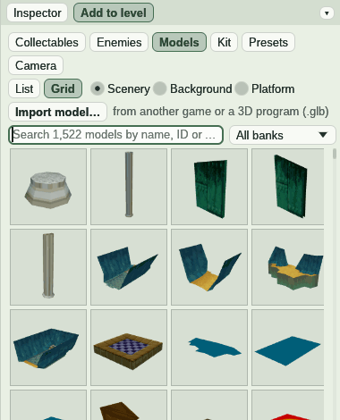
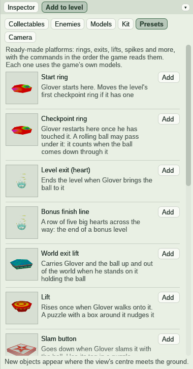

# Adding things

_Back to the [guide](README.md)_

`+ Add` (or `A`) opens the palette on the right.

## Where new things go

New things appear where the middle of the view meets the ground.

1. Look at the spot.
2. Click `Add` next to what you want.
3. Move it with the gizmo!

The new thing is selected, ready to move.

## The six tabs

| Tab | What's in it |
| --- | --- |
| `Collectables` | Garibs, every powerup, Mr. Tip |
| `Enemies` | All 52 types |
| `Models` | All 1,522 models in the game, and your own |
| `Kit` | Custom pre-made props |
| `Presets` | Ready-made platforms: rings, exits, lifts, buttons |
| `Camera` | Camera zones |

## List or Grid

`Enemies`, `Models` and `Kit` have a `List` and a `Grid` button at the top.

- Hover over a picture for its name and notes.
- A dimmed picture can't be placed that way. Click it to see why (status bar).
- A kit picture with `•••` in the corner has settings - click the 3 dots to open.

`List` brings the rows back.

### Collectables

A new garib joins the selected garib's group. If no garib is selected, it starts a new group.

`Shift`+click the ground just drops a garib right where you clicked.

### Enemies

- A new enemy comes with a script that type has in a vanilla level.
- `in this level` means the level has its model already.
- `imports from` means the model is copied in from another world when you build.
- `boss` enemies are tied to their arenas. They probably won't work properly anywhere else.

_[Enemies](Enemies.md)_ shows how to change what it does.

### Models

A bank is a group of models that the game loads together.

Search by name, or pick a bank. `This level’s banks` shows what the level has already.

| Button | What it do |
| --- | --- |
| `Scenery` | A solid piece. Glover and the ball can stand on it. |
| `Background` | Decoration. Things go through it. |
| `Platform` | Similar to Scenery. A solid piece that can move and spin. Woah! |

A model from another level is copied in when you build. The `Checks` list every one.

`Import model…` brings in a model of your own. _[Import your own model](Import-your-own-model-(untested).md)_ has the steps. I never tested this so good luck lol

### Kit

Props made for the halloween rom hack: gravestones, signposts with your words, pumpkins, ruins, creatures.

### Presets

Platforms that are already built and work: a start ring, a checkpoint ring, a level exit, a lift, a slam button, a spinner and more. Looks weird on some levels in the panel.

_[Platforms](Platforms.md)_ shows how to build a lift with one. _[The reference](../Using-the-editor.md#presets)_ lists them all.

### Camera

Boxes that move the camera while Glover is inside. _[Puzzles and camera zones](Puzzles-and-camera-zones.md)_ has more.

---

_[← Selecting and moving](Selecting-and-moving.md)_ · _[Contents](README.md)_ · _[Platforms →](Platforms.md)_
