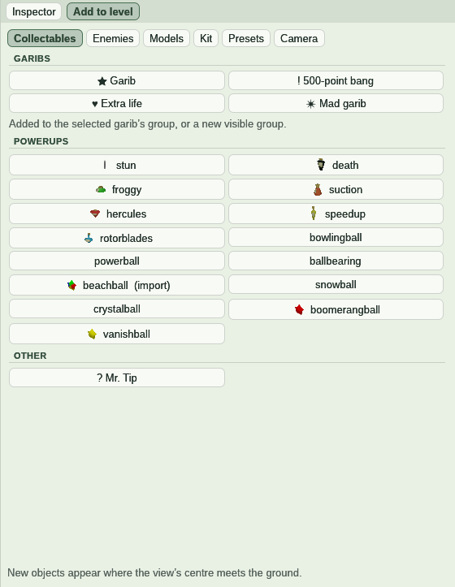
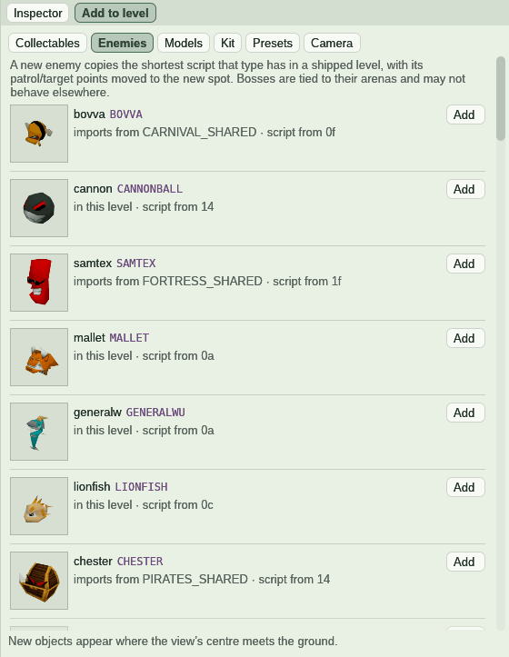
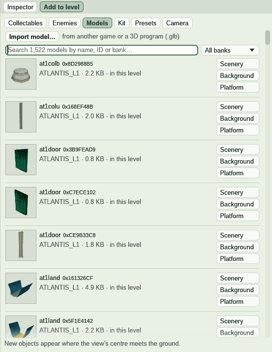
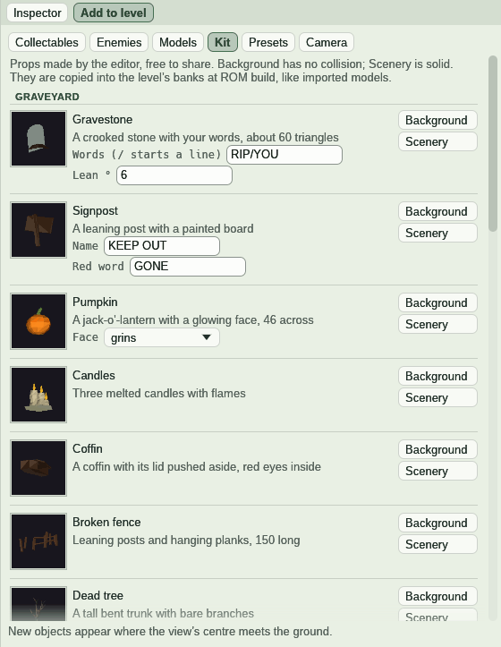
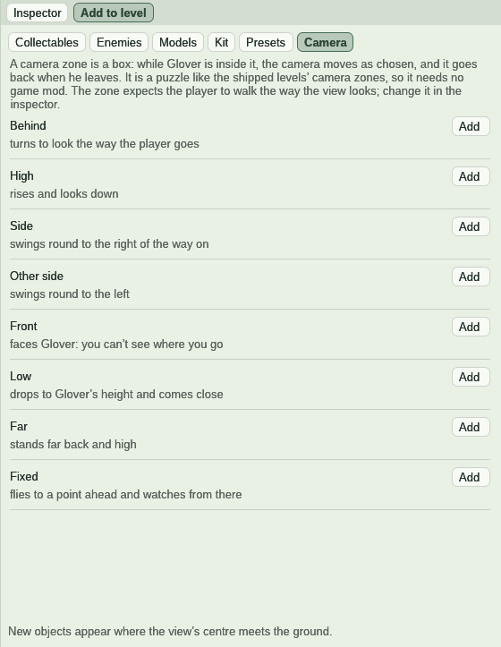

# Adding things

_Back to the [guide](README.md)_

`+ Add` (or `A`) opens the palette on the right.

## Where new things go

New things appear where the middle of the view meets the ground.

1. Look at the spot
2. Press `Add` next to what you want
3. Move it with the gizmo

The new thing is selected, ready to move.

## The six tabs

| Tab | What's in it |
| --- | --- |
| `Collectables` | Garibs, every powerup, Mr. Tip |
| `Enemies` | All 52 types |
| `Models` | All 1,522 models in the game, and your own |
| `Kit` | Props the editor makes itself |
| `Presets` | Ready-made platforms: rings, exits, lifts, buttons |
| `Camera` | Camera zones |

### Collectables

A new garib joins the selected garib's group. With no garib selected it starts a new group.

`Shift`+click the ground drops a garib right there, palette or not.

### Enemies

- A new enemy comes with a script that type has in a shipped level
- `in this level` means the level has its model already
- `imports from` means the model is copied in from another world when you build
- `boss` enemies are tied to their arenas. They may not behave anywhere else

_[Enemies](Enemies.md)_ shows how to change what it does.

### Models

Search by name, or pick a bank. `This level’s banks` shows what the level has already.

| Button | You get |
| --- | --- |
| `Scenery` | A solid piece. Glover and the ball stand on it |
| `Background` | Decoration. Things go through it |
| `Platform` | A solid piece that can move and spin |

A model from another level is copied in when you build. The `Checks` list every one.

`Import model…` brings in a model of your own. _[Import your own model](Import-your-own-model.md)_ has the steps.

### Kit

Props the editor makes itself: gravestones, signposts with your words, pumpkins, ruins, creatures.

They hold no game data. The picture follows what you type.

### Presets

Platforms that already work: a start ring, a checkpoint ring, a level exit, a lift, a slam button, a spinner and more.

_[Platforms](Platforms.md)_ builds a lift with one. _[The reference](../Using-the-editor.md#presets)_ lists them all.

### Camera

Boxes that move the camera while Glover is inside. _[Puzzles and camera zones](Puzzles-and-camera-zones.md)_ has more.

---

_[← Selecting and moving](Selecting-and-moving.md)_ · _[Contents](README.md)_ · _[Platforms →](Platforms.md)_
