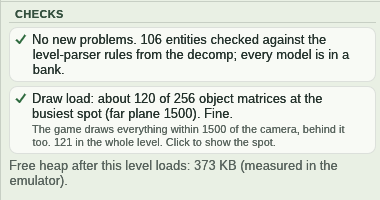
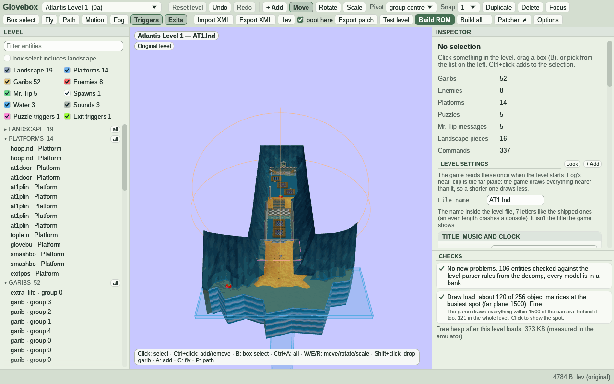

# The checks

_Back to the [guide](README.md)_

The `Checks` run the game's own level rules on your level, after every edit.

## Reading it

- A tick means fine
- A problem says what's wrong and on which object
- Click a row that names an object to select it and look at it
- Many rows link to the place in the game's code that makes the rule
- Problems the shipped level already has are labelled. Those aren't yours

In the `Level` panel, the name of an object with an error changes colour.

_[The reference](../Using-the-editor.md#checks)_ lists what gets checked.

## Draw load

The game draws everything within its far plane, even what's behind the camera.

Too much at once and it lags. Past 256 it stops.

| Estimate | What it means |
| --- | --- |
| Under 190 | Fine |
| 190 to 239 | It slows down |
| 240 or more | At or near the limit |

Click the row. The view goes to the busiest spot and draws the far plane round it.

Everything inside the rings is drawn when Glover stands in the middle.

To fix a high number, put fewer pieces close together, or shorten the far plane (`near_clip` in `FogConfiguration`).

Note: it's an estimate.

## Memory

Under the rows, the panel says how much memory the level leaves free.

When you add models from other levels it lists each import, and shows a bar of the memory they take.

---

_[← Level settings](Level-settings.md)_ · _[Contents](README.md)_ · _[Import your own model →](Import-your-own-model.md)_
