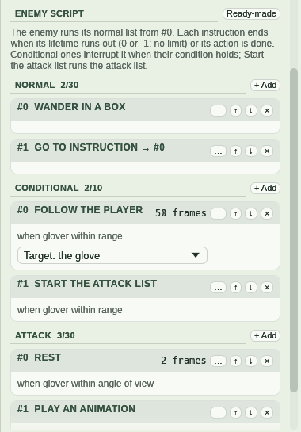
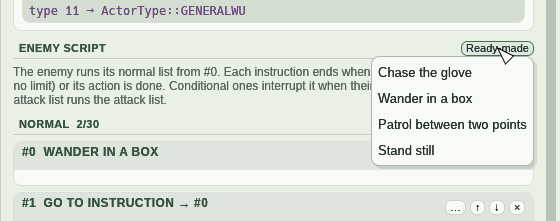

# Enemies

_Back to the [guide](README.md)_

## Place one

1. Look at the spot.
2. `+ Add`, then `Enemies`.
3. Click `Add` next to the enemy.

It comes with a script it has in a vanilla level, moved to the new spot.

## Turn and size

- Turning it on the Y axis sets the way it faces at the start.
- Tilting it, and scaling it, need the game mod _(see [The Expansion Pak game mod](../Game-mod.md))_

## The script

Select an enemy and scroll down in the Inspector to `ENEMY SCRIPT`.

It has three lists:

| List | When it runs | Maximum |
| --- | --- | --- |
| `NORMAL` | All the time, from #0. | 30 |
| `CONDITIONAL` | When its condition holds. It interrupts the normal list. | 10 |
| `ATTACK` | When an instruction starts the attack list. | 30 |

The buttons on each instruction:

| Button | What it do |
| --- | --- |
| `+ Add` | Adds an instruction to that list. |
| `…` | Shows or hides the instruction's fields. |
| `↑` `↓` | Move it. "Go to" targets follow. |
| `×` | Removes it. |

Follow, flee and face have a `Target`: the glove, the ball, or the closer one.

## Ready-made scripts

`Ready-made` swaps in a whole normal list.

### A list that runs off its end is an error!

End a list with `Go to instruction`. The `Checks` tell you when one is missing.

More than 30 normal, 10 conditional or 30 attack instructions crash the game. The `Checks` count them.

## Bosses

Boss enemies are tied to their arenas. The palette marks them with `boss`.

---

_[← Platforms](Platforms.md)_ · _[Contents](README.md)_ · _[Puzzles and camera zones →](Puzzles-and-camera-zones.md)_
