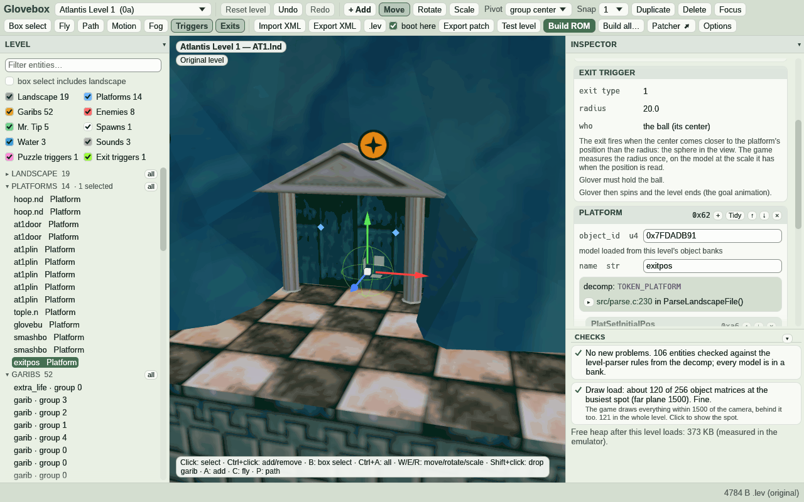
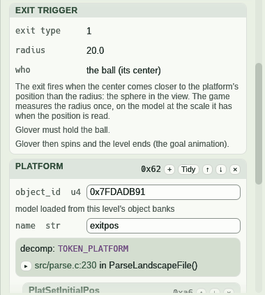

# Exits

_Back to the [guide](README.md)_

Every exit is a platform with an `Exit` command.

## See the sphere

`Exits` in the toolbar shows or hides the green spheres. They are drawn at their real size.

- Clicks go through the sphere. You can still select what's inside it.
- The outline shows faintly through walls.
- A moving platform's sphere is drawn where the platform starts.

## Who has to touch it

Select the platform. The `Exit trigger` card tells you the radius, who has to get inside and what else the game wants.

It's the center of Glover or the ball that counts, not the edge.

_[The reference](../Using-the-editor.md#exit-triggers)_ has the table for every exit type.

## Make an exit

`+ Add`, then `Presets`:

| Preset | What it is |
| --- | --- |
| `Level exit (heart)` | Bring the ball to it to end the level. |
| `Exit zone` | An invisible level exit. |
| `Bonus finish line` | Five big hearts across the way, for a bonus level. |
| `World exit lift` | Stand on it with the ball and it carries you out of the world. |

## Make it bigger

The size comes from the platform's model and its scale.

Scale the platform and the sphere scales with it.

### An exit with a radius of 0 can never fire!

The `Checks` warn you when a level has one. _[The reference](../Using-the-editor.md#an-exit-with-a-radius-of-0-can-never-fire)_ says why it happens.

---

_[← Puzzles and camera zones](Puzzles-and-camera-zones.md)_ · _[Contents](README.md)_ · _[The Path tool →](Path.md)_
