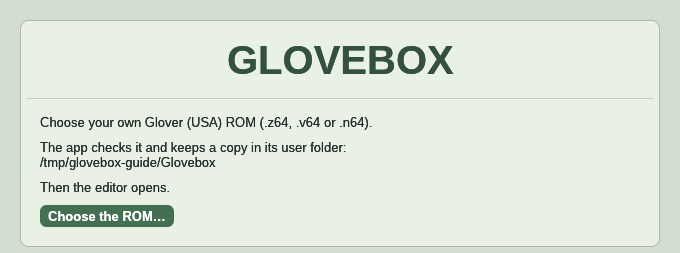
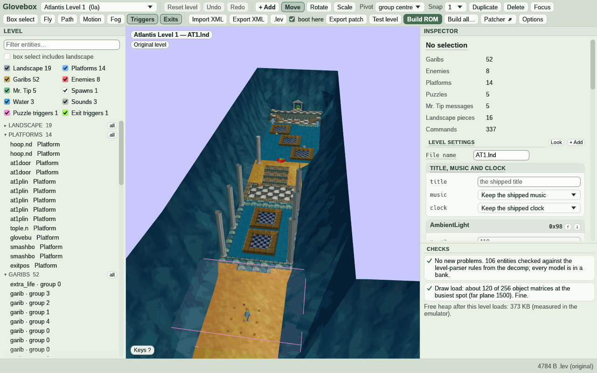

# Getting started

_Back to the [guide](README.md)_

## You need your own ROM!

Glover (USA) as a `.z64`, `.v64` or `.n64` file.

The editor has no game data of its own. Everything it shows comes from your ROM.

## Get the app

1. Get the app for Windows from the _[releases page](https://github.com/Eddie-Lack/Glovebox/releases)_
2. Unzip it
3. Start `Glovebox.exe`

It doesn't install anything.

### Windows says it protected your PC!

The app isn't signed, that's all.

Choose `More info`, then `Run anyway`.

## Choose your ROM

The first time, the app asks for your ROM.

1. Press `Choose the ROM…`
2. Pick your ROM

Dropping the file on the window works too.

The app checks it's the right game and keeps a copy in its user folder. The screen shows where that is.

Then the editor opens. There's nothing to wait for.

## Open a level

The editor starts on Atlantis Level 1. Later it starts on the level you had open last.

Pick another level in the list at the top. All 48 are there.

## Take the tour

The first time, the editor asks if you want a quick tour.

`Show me round` walks you through the window, one part at a time.

- `Next` and `Back` move between the steps
- `Skip` or `Esc` ends it
- It doesn't change your level
- Said `No thanks`? `Options` > `Take the tour` starts it any time

## Your edits save themselves

- Every edit is saved in the user folder
- Close the editor, open it again, and your edits are back
- The chip in the corner of the view says `Original level` or `Edited`
- The level list marks edited levels with ●
- `Reset level` gives you the shipped level back. `Undo` still brings your edits back

---

_[Contents](README.md)_ · _[The window →](The-window.md)_
