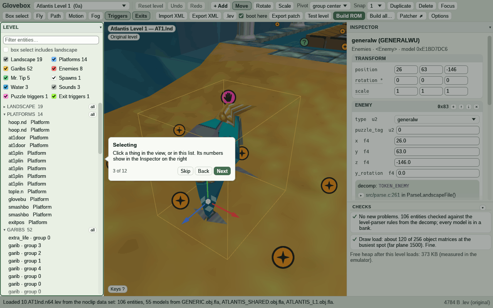
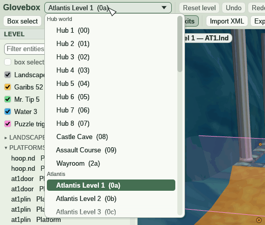

# Getting started

_Back to the [guide](README.md)_

## You need your own ROM!

Glover (USA) as a `.z64`, `.v64` or `.n64` file.

The editor has no game data of its own. Everything it shows comes from your ROM.

## Get the app

1. Get the app for Windows from the _[releases page](https://github.com/Eddie-Lack/Glovebox/releases)_.
2. Unzip it.
3. Start `Glovebox.exe`.

It doesn't install anything.

### Windows says it protected your PC?

The app isn't signed, that's all.

Choose `More info`, then `Run anyway`.

## Choose your ROM

The first time, the app asks for your ROM.

1. Click `Choose the ROM…`.
2. Pick your ROM.

Dropping the file on the window works too.

The app checks it's the right game and keeps a copy in its user folder. The screen shows where that is.

Then the editor opens.

## Open a level

The first time you open it, the editor starts on Atlantis Level 1. Later, it'll start on the level you had open last.

Pick another level in the list at the top.

## Take the tour

The first time, the editor asks if you want a quick tour.

- Click `Skip` or press `Esc` to end it.
- Said `No thanks`? `Options` > `Take the tour` starts it any time.

## File names are dumb!!!
The game will crash if the file name is an even number of characters in length. Seriously lol [check out the Level Settings page](Level-settings.md#file-name).

## Edits are saved

- Every edit is saved in the user folder.
- If you close the editor, your edits are saved for when you come back.
- The box in the corner of the view says `Original level` or `Edited`.
- The level list marks edited levels with ●.
- `Reset level` gives you the vanilla level back. `Undo` still brings your edits back.

---

_[Contents](README.md)_ · _[The editor →](The-editor.md)_
