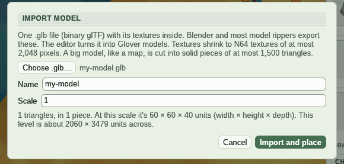

I dunno how to use blender so I never actually tested this at all lol. Good luck!

# Import your own model

_Back to the [guide](README.md)_

You need one `.glb` file with its textures inside. Blender exports these.

1. `+ Add`, then `Models`.
2. Click `Import model…`.
3. Click `Choose .glb…` and pick the file.
4. Give it a name and a scale.
5. Click `Import and place`.

Dropping a `.glb` on the window opens the same dialog.

The dialog says how many triangles it has, how many pieces it becomes and how big it is next to the level.

The pieces appear as Scenery in the middle of the view. One `Undo` takes them all back.

## Use it again

`YOUR IMPORTED MODELS` at the top of the `Models` tab lists what you imported.

- `Place` adds all the pieces again
- `Remove` deletes the model

Your models are in every level.

### Don't make a platform from your own model!

It crashes a console. Use `Scenery` or `Background`.

Note: the patch you export holds your models. Only share models you have the right to share.

_[Import model](../Import-model.md)_ has the limits and the details.

---

_[← The checks](Checks.md)_ · _[Contents](README.md)_ · _[Test, build and share →](Test-build-and-share.md)_
