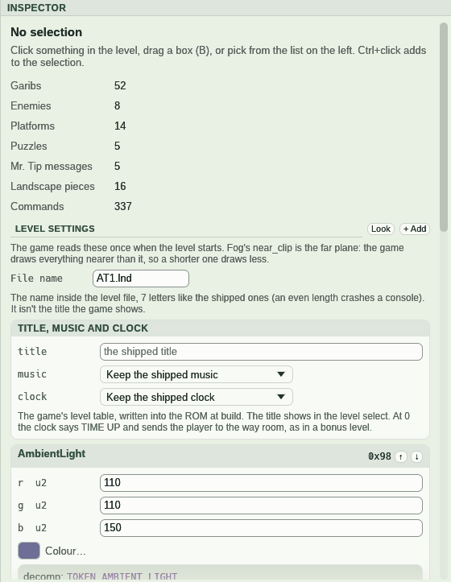
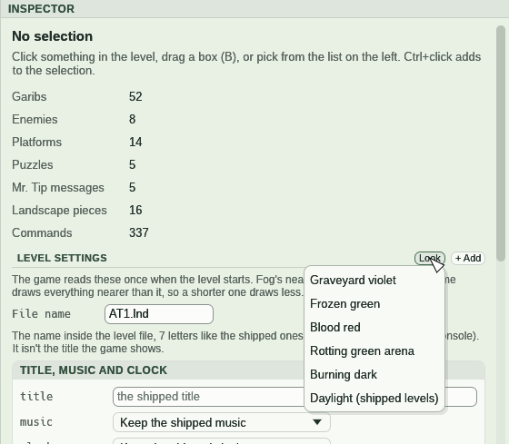

# Level settings

_Back to the [guide](README.md)_

Select nothing (`Esc`) and the Inspector shows the level's settings.

## Title, music and clock

| Field | What it sets |
| --- | --- |
| `title` | The name in the level select |
| `music` | The level's music |
| `clock` | A countdown, like a bonus level's |

They go into the ROM when you build.

Note: at 0 the clock says TIME UP and sends you to the way room.

Note: a ROM that boots straight into the level (`boot here`, `Test level`) plays its own music, not yours.

## Look

`Look` sets the lights and the fog to a preset.

`Daylight (shipped levels)` goes back to a normal day.

## Fog, lights and more

Scroll down for the cards of the lights and the fog. Each field is a number you can type or drag.

`+ Add` adds what the level doesn't have yet: fog, lights, a backdrop, gravity or an ambient sound.

To see less fog while you edit, use `Fog` in the toolbar. That one only changes the editor.

## File name

`File name` is the name inside the level file. It isn't the title.

### Keep the file name 7 letters long!

A name with an even number of letters crashes a console.

---

_[← The Path tool](Path.md)_ · _[Contents](README.md)_ · _[The checks →](Checks.md)_
