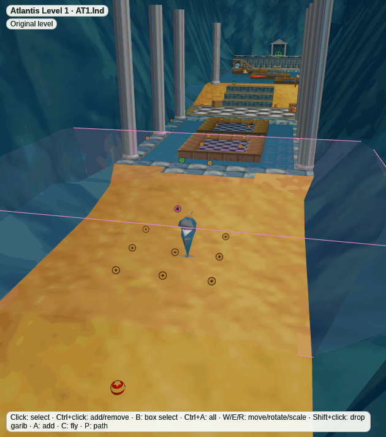
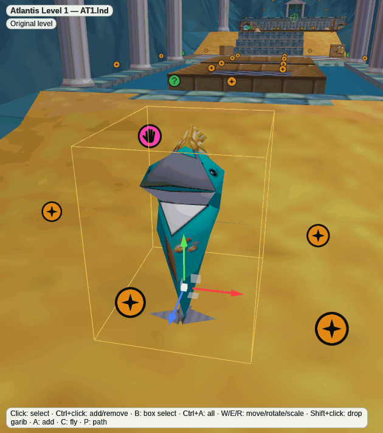
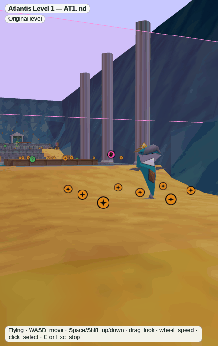

# Moving around

_Back to the [guide](README.md)_

| Orbit | Focus | Fly |
| --- | --- | --- |
|  |  |  |

## Orbit

| Mouse action | Camera action |
| --- | --- |
| Drag | turns around the point it looks at |
| Right-click+drag | slides sideways and up and down |
| Scroll wheel, or middle-click+drag | goes in and out |

## Focus

Select something, then press `F` (or `Focus`).

The camera goes to the object and looks at it. Dragging now turns around that object.

## Fly

`Fly` (or `C`) gives you a free camera.

- `W` `A` `S` `D` move along the view
- `Space` goes straight up, `Shift` straight down
- Drag to look around
- The scroll wheel sets the speed
- `C` or `Esc` goes back to orbiting

Note: while you fly, those keys move the camera. Use the toolbar for `Move` and `+ Add`.

## Fog

`Fog` shows or hides the level's fog in the view.

It only changes what you see in the editor. The pictures in this guide have it off.

---

_[← The editor](The-editor.md)_ · _[Contents](README.md)_ · _[Selecting and moving →](Selecting-and-moving.md)_
