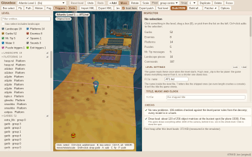
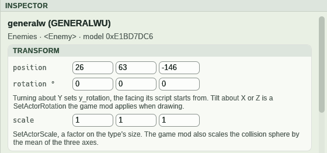

# Options

_Back to the [guide](README.md)_

`Options` is at the end of the toolbar.

## Theme

Pick a look. The window changes right away.

| | | |
| --- | --- | --- |
|  |  |  |
| `1998` | `Dark` | `Blueprint` |
|  |  |  |
| `Sage` | `Sand` | `Slate` |

- There are 15 of them
- The editor remembers your theme
- Only the look changes. Every button stays where it is

This guide uses `Sage`.

## Info texts

The small texts under titles and fields explain how the game or the editor works.

| `Shown` | `On hover` |
| --- | --- |
|  |  |

| Choice | What you get |
| --- | --- |
| `Shown` | Every text in its place |
| `On hover` | No texts. Rest the pointer on a title or a field to read its text |
| `Off` | No texts at all |

- On hover, a dotted line under a name means it has a text
- Checks, warnings, values and names always stay
- The editor remembers your choice

---

_[← Test, build and share](Test-build-and-share.md)_ · _[Contents](README.md)_ · _[Keys →](Keys.md)_
