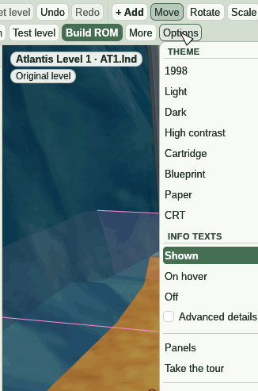
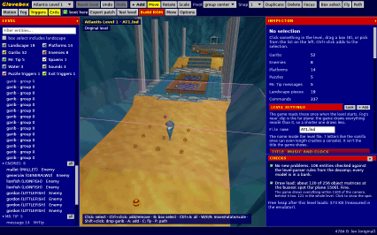
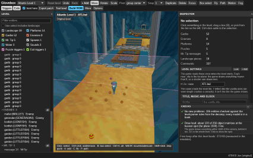
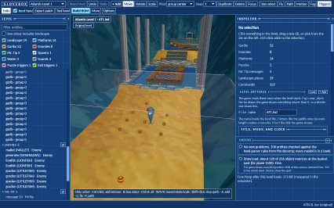
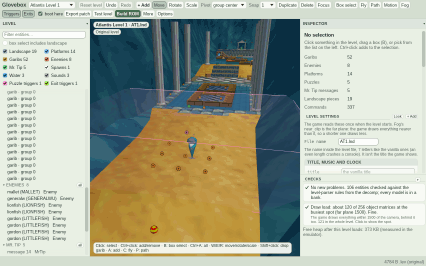
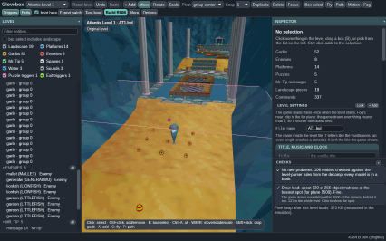
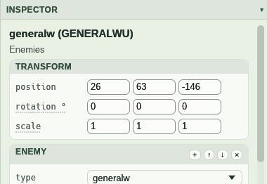

# Options

_Back to the [guide](README.md)_

`Options` is at the end of the toolbar.

## Theme

There's 15 themes to pick from. This guide uses `Sage`.

The editor starts with `1998`.

| | | |
| --- | --- | --- |
|  |  |  |
| `1998` | `Dark` | `Blueprint` |
|  |  |  |
| `Sage` | `Sand` | `Slate` |

## Info texts

Small texts explain how the game or the editor works. They start `On hover`.

| `Shown` | `On hover` |
| --- | --- |
|  |  |

| Option | What it do |
| --- | --- |
| `Shown` | Every info text in its place, under its title or field. |
| `On hover` | No info text. Hover over a title or a field to read its text. This is what you start with. |
| `Off` | No info text at all. |

- On hover, a dotted line under a name means it has info text.
- Checks, warnings, values and names always stay.
- The editor remembers your choice.

## Advanced details

Off at first. Turn it on to see the level format's and the game code's details:

- each field's type (`f4`, `u2`…) and each command's number (`0x98`)
- the command's place in the game's code, with links into _[gloveworld](https://github.com/Eddie-Lack/gloveworld)_
- model ids, and the level ids in the level list (`Atlantis Level 1  (0a)`)

With it off, the `Level` panel calls a few common models by their preset's name: `Checkpoint ring`, `Level exit (heart)`, `Slam button`

The editor remembers your choice

## Panels

`Panels` moves and hides the panels. See _[The editor](The-editor.md#arranging-the-panels)_.

## Take the tour

`Take the tour` walks you through the first start tour again. See _[Getting started](Getting-started.md#take-the-tour)_.

## The rest

- `Choose your emulator…` picks the program `Test level` opens
- `Open the user folder` opens the folder with your edits, settings and `editor.log`
- `Open the guide ↗` opens this guide
- The last line is the app's version

---

_[← Test, build and share](Test-build-and-share.md)_ · _[Contents](README.md)_ · _[Keys →](Keys.md)_
