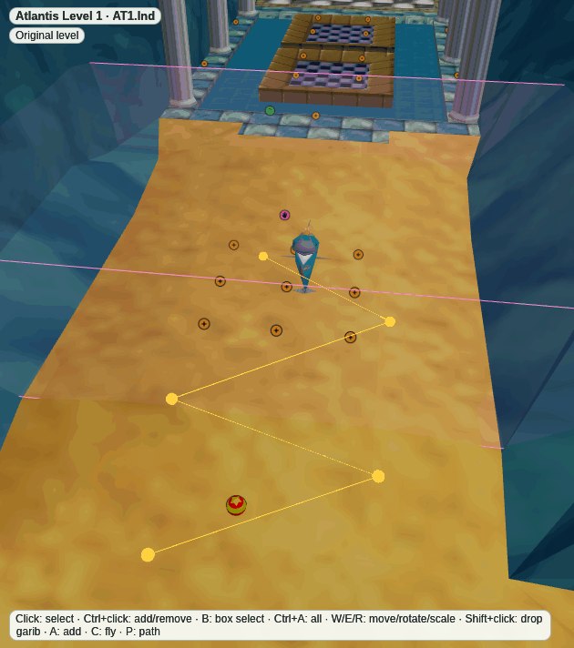
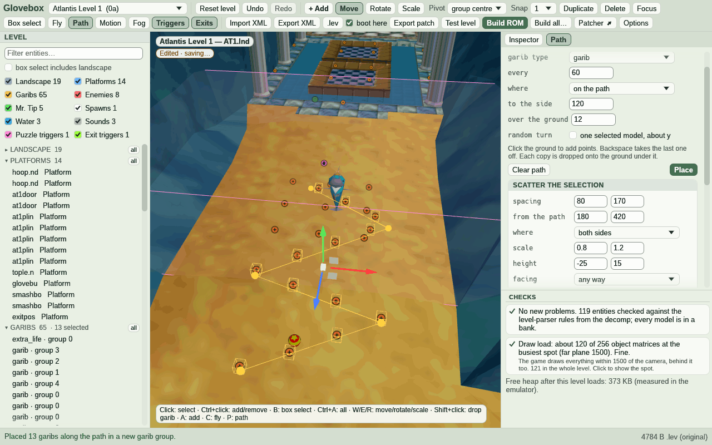
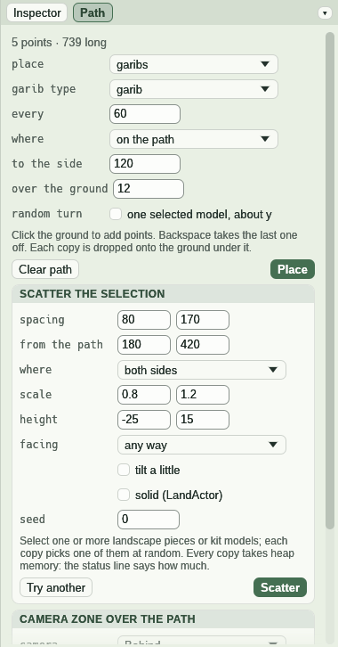

# The Path tool

_Back to the [guide](README.md)_

`Path` (or `P`) lays a line on the ground and places things along it.

## Lay the path

1. Click `Path`.
2. Click the ground, point after point.

`Backspace` takes the last point off. `Clear path` takes them all.

## Place garibs

3. Click `Place`.

Each garib lands on the ground under it.

## The settings

| Setting | What it does |
| --- | --- |
| `place` | `garibs`, or `copies of the selection` |
| `garib type` | Garib, 500-point bang, extra life or mad garib |
| `every` | How far apart they go |
| `where` | On the path, to the right, to the left, or both sides |
| `to the side` | How far from the path the side ones go |
| `over the ground` | How high they sit |
| `random turn` | Spins each copy of a single model |

`copies of the selection` works with scenery, kit props, enemies, powerups and Mr. Tip.

## Scatter

`Scatter` puts copies of the selected scenery beside the path, at random.

- Set the ranges for spacing, distance, scale and height.
- Select a few models and each copy picks one of them.
- `Try another` takes it back and tries again.

## Camera zones over the path

`Add zones` covers a stretch of the path with camera zones. A long stretch gets several boxes.

Note: the path is only a guide.

---

_[← Exits](Exits.md)_ · _[Contents](README.md)_ · _[Level settings →](Level-settings.md)_
