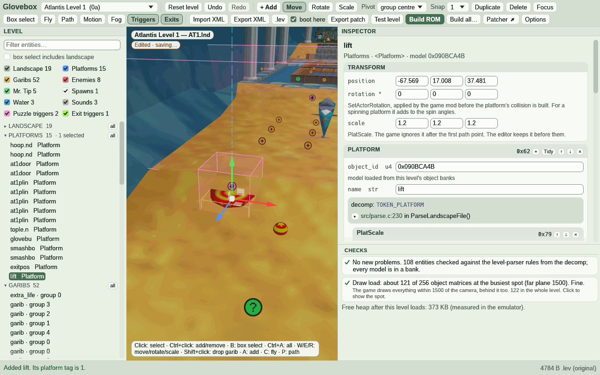
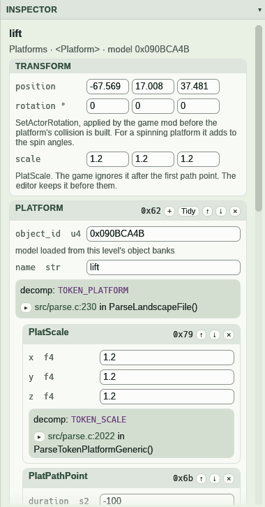
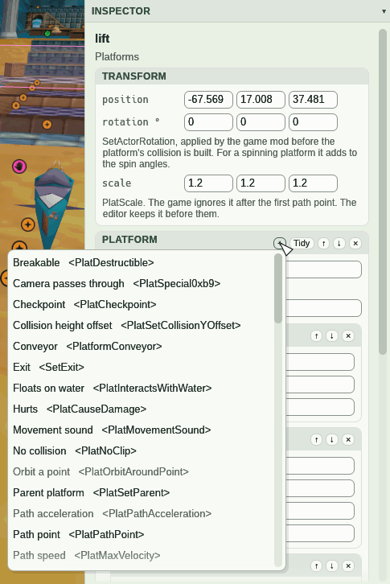

# Platforms

_Back to the [guide](README.md)_

A platform is a model with a list of commands: where it starts, where it goes, what it does.

The quick way to a working one is a preset.

## A lift, step by step

1. Look at the spot where the lift goes.
2. `+ Add`, then `Presets`.
3. Click `Add` next to `Lift`.

4. Move it into place with the gizmo.
5. Click `Test level` and walk onto it.

The lift rises once when Glover walks onto it.

The pink box is its trigger. It belongs to a puzzle that came with the lift. _[Puzzles and camera zones](Puzzles-and-camera-zones.md)_ shows how to open it.

The line going up from the lift is its path. Each point on it can be selected and moved.

## The cards

Select a platform and the Inspector shows its commands, one card each, in the order the game reads them.

The small buttons on a card:

| Button | What it do |
| --- | --- |
| `+` | Adds a command inside this one. |
| `↑` `↓` | Move the command earlier or later. |
| `×` | Removes it, and anything that only worked with it. |
| `Tidy` | Puts the commands back in an order the game reads right. |

- New commands start with the values the vanilla levels use
- A move the game would read wrong is refused

## Adding a command

Click `+` on the `Platform` card and pick one.

The gray ones can't go on this platform. Hover over one to see why.

## Things that spin and move

- `Spinner` turns about its center all the time
- `Moving platform` goes back and forth between two points
- `Conveyor` pushes what stands on it
- `Ice floor` lets the ball keep its speed

Select an object in the level first and these four use its model.

Your imported models work for these too.

`Motion` in the toolbar spins the spinning platforms in the view.

---

_[← Adding things](Adding-things.md)_ · _[Contents](README.md)_ · _[Enemies →](Enemies.md)_
