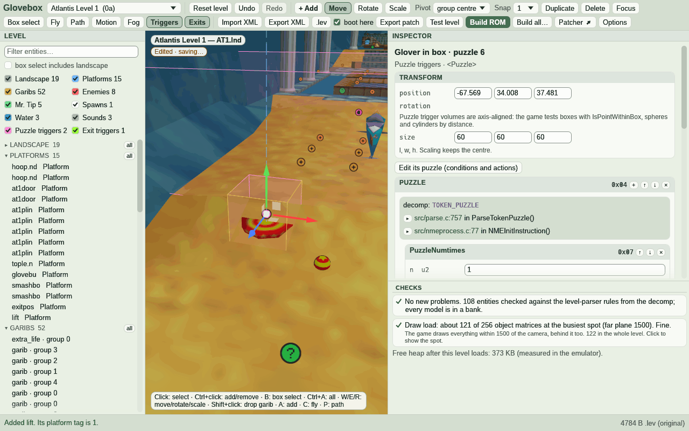
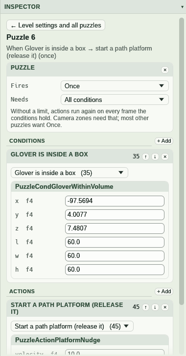
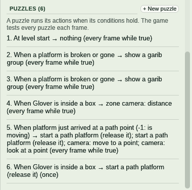
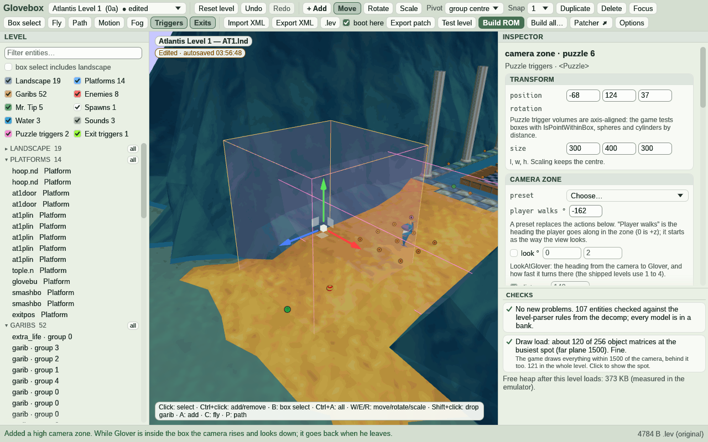
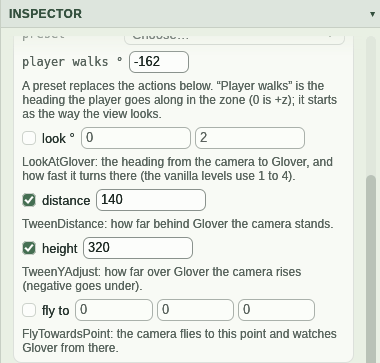

# Puzzles and camera zones

_Back to the [guide](README.md)_

A puzzle is "when this, do that".

The "when" is its conditions. The "do" is its actions. Simple!

## Trigger volumes

A condition that tests where something is has a shape in the view.

| Color | Who it tests |
| --- | --- |
| Pink | Glover |
| Orange | The ball |
| Purple | The camera |

- Click a shape to select it.
- Move it and resize it with the gizmo! Or in the Inspector.
- `Triggers` in the toolbar shows or hides them all.

## Open a puzzle

Select a trigger volume and click `Edit its puzzle` in the Inspector.

- `Fires`: every frame while true, once, or a number of times.
- `Needs`: all conditions, any condition, or at least a number of them.
- `+ Add` adds a condition or an action. Pick its type in its card.
- A puzzle without any condition fires when the level starts.

Note: a puzzle without a limit runs its actions on every frame its conditions hold. Most puzzles want `Once`.

## All the puzzles of a level

With nothing selected, the Inspector lists every puzzle. Click one to open it.

`+ New puzzle` starts an empty one.

## Camera zones

A camera zone is a box. While Glover is inside it the camera moves, and when he leaves the zone it goes back to normal.

1. Look the way the player will walk.
2. `+ Add`, then `Camera`.
3. Click `Add` next to a zone.

| Zone | The camera |
| --- | --- |
| `Behind` | turns to look the way you go |
| `High` | rises and looks down on Glover |
| `Side` and `Other side` | swings around to the right or the left |
| `Front` | faces Glover |
| `Low` | drops to Glover's height and comes close |
| `Far` | stands far back and high |
| `Fixed` | flies to a point ahead and watches from there |

Move and size the box like any trigger volume.

The `Camera zone` card changes the preset, the heading, the look angle, the distance, the height and the point to fly to.

The _[Path tool](Path.md)_ can cover a whole stretch with zones.

---

_[← Enemies](Enemies.md)_ · _[Contents](README.md)_ · _[Exits →](Exits.md)_
