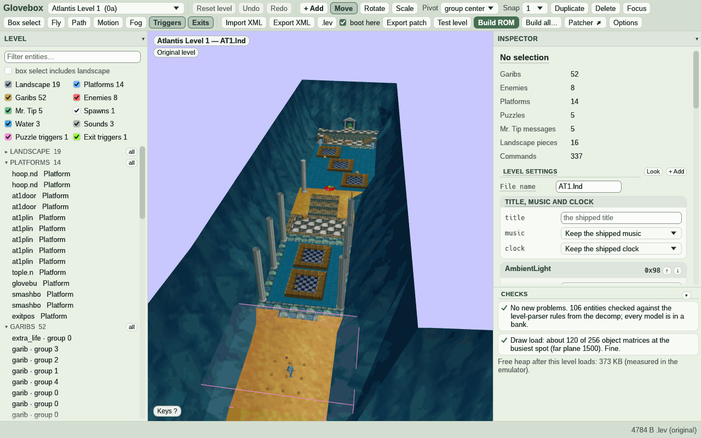
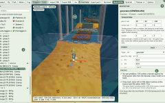
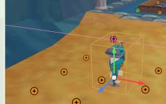
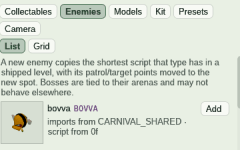
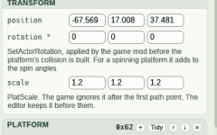
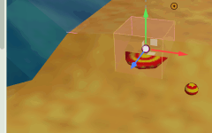
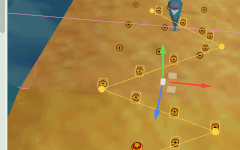
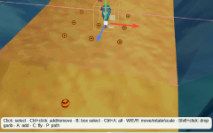

# Glovebox User Manual

_Back to the [README](../../README.md)_

Guide to using Glovebox - the Glover level editor.

New here? Start with _[Getting started](Getting-started.md)_.

## Contents

| | Page |
| --- | --- |
|  | _[Getting started](Getting-started.md)_ |
|  | _[The editor](The-editor.md)_ |
|  | _[Moving around](Moving-around.md)_ |
|  | _[Selecting and moving](Selecting-and-moving.md)_ |
|  | _[Adding things](Adding-things.md)_ |
|  | _[Platforms](Platforms.md)_ |
|  | _[Enemies](Enemies.md)_ |
|  | _[Puzzles and camera zones](Puzzles-and-camera-zones.md)_ |
|  | _[Exits](Exits.md)_ |
|  | _[The Path tool](Path.md)_ |
|  | _[Level settings](Level-settings.md)_ |
|  | _[The checks](Checks.md)_ |
| .md) | _[Import your own model](Import-your-own-model-(untested).md)_ |
|  | _[Test, build and share](Test-build-and-share.md)_ |
|  | _[Options](Options.md)_ |
|  | _[Keys](Keys.md)_ |

## More

- _[Using the editor](../Using-the-editor.md)_
- _[Sharing levels](../Sharing-levels.md)_
- _[Import model](../Import-model.md)_
- _[The Expansion Pak game mod](../Game-mod.md)_

The pictures also show the info texts in the panels. By default, the info text will be hidden and only show when you hover over a name.

---

_[Getting started →](Getting-started.md)_
