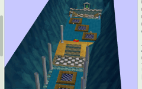
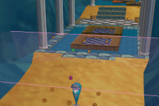
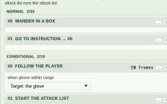
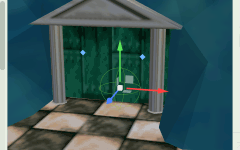
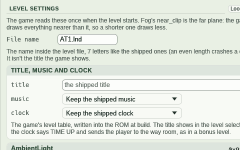
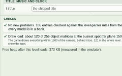
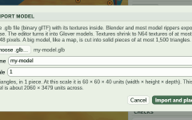
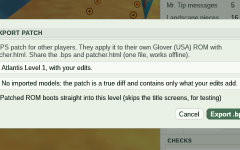
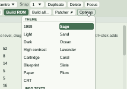

# The Glovebox guide

_Back to the [README](../../README.md)_

How to use the editor, one job at a time, with pictures.

New here? Start with _[Getting started](Getting-started.md)_ and go page by page.

## Contents

| | Page | What's in it |
| --- | --- | --- |
|  | _[Getting started](Getting-started.md)_ | Get the app, give it your ROM, open a level |
|  | _[The window](The-window.md)_ | A tour of the window, part by part |
|  | _[Moving around](Moving-around.md)_ | Orbit, pan, zoom, fly and focus |
|  | _[Selecting and moving](Selecting-and-moving.md)_ | Click, box select, the gizmo and the number fields |
|  | _[Adding things](Adding-things.md)_ | Garibs, powerups, enemies, models, props and ready-made platforms |
|  | _[Platforms](Platforms.md)_ | A lift step by step, and the command cards |
|  | _[Enemies](Enemies.md)_ | Place an enemy and change its script |
|  | _[Puzzles and camera zones](Puzzles-and-camera-zones.md)_ | Make things happen when Glover gets somewhere |
|  | _[Exits](Exits.md)_ | The sphere that ends the level |
|  | _[The Path tool](Path.md)_ | Lay a path and put garibs along it |
|  | _[Level settings](Level-settings.md)_ | Title, music, clock, fog and the look of the level |
|  | _[The checks](Checks.md)_ | What the Checks panel tells you |
|  | _[Import your own model](Import-your-own-model.md)_ | Bring in a model from Blender or another game |
|  | _[Test, build and share](Test-build-and-share.md)_ | Play your level, build a ROM, make a patch |
|  | _[Options](Options.md)_ | Themes and the info texts |
|  | _[Keys](Keys.md)_ | Every shortcut in one table |

## More

- _[Using the editor](../Using-the-editor.md)_ is the full list of what the editor does
- _[Sharing levels](../Sharing-levels.md)_
- _[Import model](../Import-model.md)_
- _[The Expansion Pak game mod](../Game-mod.md)_

Note: the pictures show the `Sage` theme. Yours looks different until you pick it in `Options`.

---

_[Getting started →](Getting-started.md)_
