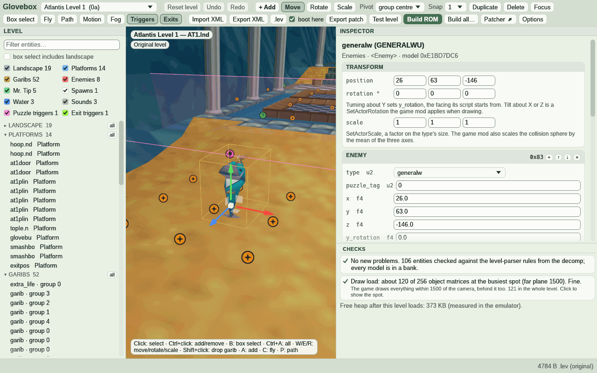
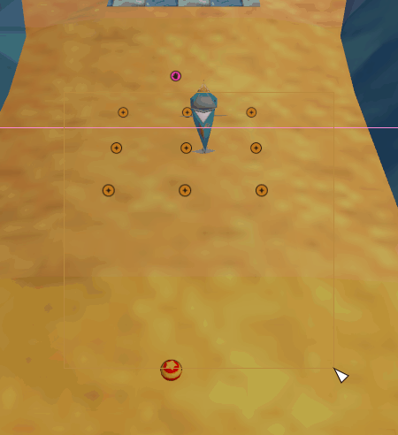
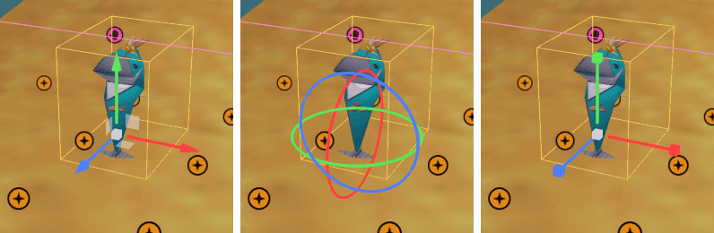
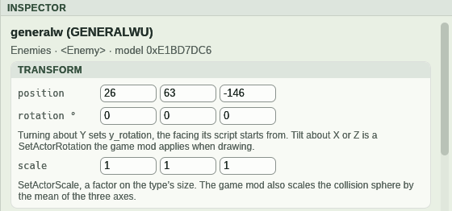
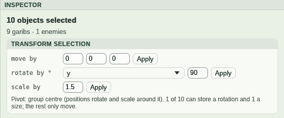

# Selecting and moving

_Back to the [guide](README.md)_

## Select

Click something in the view. It gets a box round it and the gizmo, and the Inspector shows its numbers.

- `Ctrl`+click adds to the selection, or takes away from it
- Clicking a name in the `Level` panel selects too. `Shift`+click there selects a run of names
- `Ctrl+A` selects everything you can see, except the landscape
- `Esc` selects nothing

## Box select

Press `B` (or `Box select`), then drag a box in the view.

- Hold `Shift` and the box adds to what's selected
- The landscape stays out of it. Tick `box select includes landscape` in the `Level` panel to take it too
- `Ctrl`+`Alt`+drag draws a box without the tool

## Move, rotate, scale

`W`, `E` and `R` switch the gizmo. The toolbar's `Move`, `Rotate` and `Scale` do the same.

Drag a handle. Red is X, green is Y (up), blue is Z.

- Hold `Ctrl` and the gizmo lets clicks through. That's how you click something behind it
- An enemy's script points and a platform's path move with it

Not everything can turn or grow. _[What can rotate and scale](../Using-the-editor.md#what-can-rotate-and-scale)_ has the list.

## Snap and Pivot

- `Snap` moves in steps of `1`, `10` or `50`. It also turns in steps of 15° and scales in steps of 0.05. `off` is free
- `Pivot` is for several objects: `group centre` turns them round their middle, `each origin` turns each one on its own spot

## The number fields

- Click a field to type a number
- Drag left or right on a field to change it
- Hold `Shift` for finer steps, `Ctrl` for bigger ones
- `Esc` while you drag puts the old number back

## Several at once

With several objects selected the Inspector has `move by`, `rotate by` and `scale by`. Type a number and press `Apply`.

## Undo

| Do | Key |
| --- | --- |
| Undo | `Ctrl+Z` |
| Redo | `Ctrl+Shift+Z` or `Ctrl+Y` |
| Duplicate | `Ctrl+D` |
| Delete | `Del` |

They work on the whole selection.

---

_[← Moving around](Moving-around.md)_ · _[Contents](README.md)_ · _[Adding things →](Adding-things.md)_
