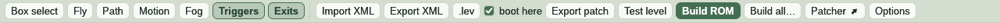
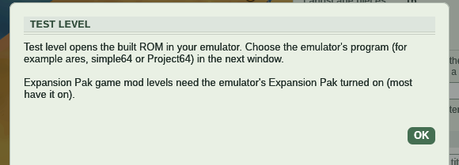
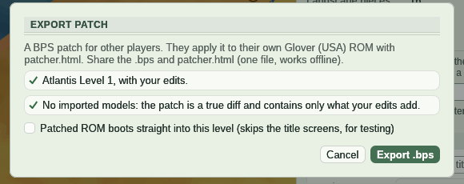
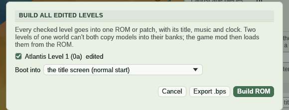

# Test, build and share

_Back to the [guide](README.md)_

The bottom row of the toolbar has it all.

## Test level

`Test level` (or `T`) builds a ROM that starts in your level and opens it in your emulator.

- The first time, press `OK` and pick your emulator's program (ares, simple64, Project64…)
- After that it's one click
- The ROM goes in the user folder (`test/`)

## Build ROM

`Build ROM` patches your edits into a ROM and asks where to save it.

Tick `boot here` and the ROM starts in your level. Without it the game starts as normal.

## Export patch

`Export patch` makes a `.bps` patch. That's the file to share: players apply it to their own ROM.

- The patch holds only what your edit changes
- It starts the game normally. Tick `Patched ROM boots straight into this level` for a patch that doesn't
- The dialog tells you when the patch needs the Expansion Pak

`Patcher ↗` opens the patcher page. It's one file and it works offline. Share it with your patch.

_[Sharing levels](../Sharing-levels.md)_ shows how players use it.

## Build all

`Build all…` puts every level you've edited into one ROM or one patch.

Pick the level it boots into, or a normal start.

## Level files

- `Export XML` saves the level as a file
- `.lev` saves it the way the game stores it
- `Import XML` reads an XML back. It checks the file first

Dropping an `.xml` on the window imports it too.

### Some levels need the Expansion Pak!

The editor adds its game mod to the ROM or patch when your level:

- rotates or scales enemies, platforms, powerups or water
- imports models
- has more scenery than the game's own memory holds
- is an extra level

The Checks and the export dialog say when that happens.

On an emulator, the Expansion Pak has to be on. Most have it on.

_[The Expansion Pak game mod](../Game-mod.md)_ has the details.

Note: every ROM and patch the editor builds uses Easy ball controls.

---

_[← Import your own model](Import-your-own-model.md)_ · _[Contents](README.md)_ · _[Options →](Options.md)_
