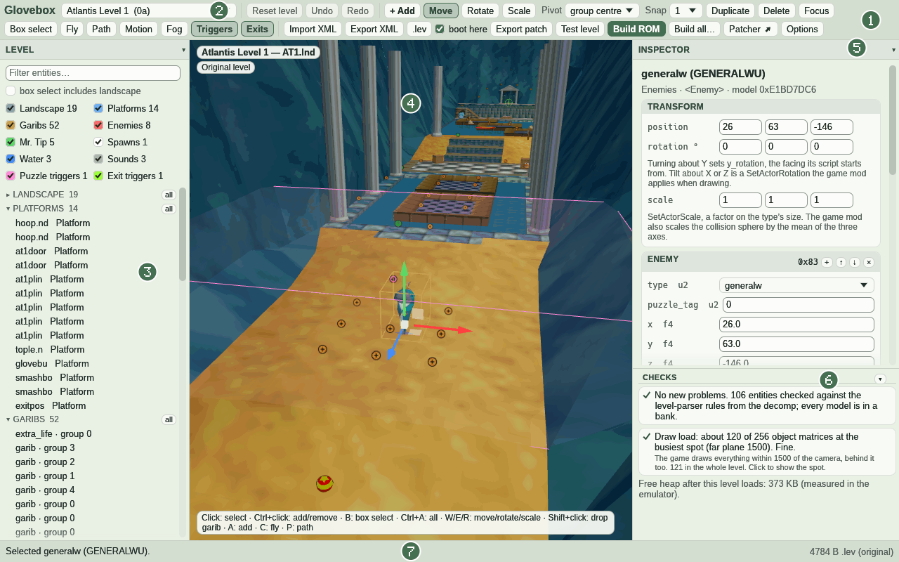
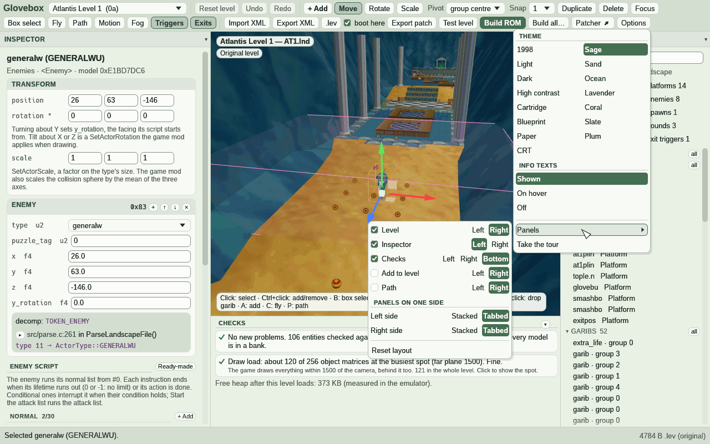
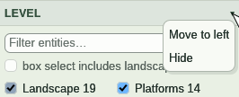

# The window

_Back to the [guide](README.md)_

1. The toolbar. The top row edits: `Undo`, `+ Add`, `Move`, `Rotate`, `Scale`, `Duplicate`, `Delete`. The bottom row has the tools, the files and the builds
2. The level list. All 48 levels of the game
3. The `Level` panel. Everything in the level, by kind. Click a name to select it
4. The view. Your level in 3D. The level's name and the autosave chip are at the top, the key hints at the bottom
5. The `Inspector`. The numbers of what you selected. With nothing selected it shows the level's settings and puzzles
6. The `Checks`. The game's own rules, run on your level after every edit
7. The status bar. It says what the last thing you did changed. The size of the level file is on the right

## The Level panel

- Type in `Filter entities…` to find something by name
- The tick boxes show and hide a whole kind: garibs, enemies, platforms and the rest
- Click a group's title to fold it
- `all` selects the whole group

Hiding a kind only changes the view. The level keeps everything.

## The tabs on the right

`+ Add` and `Path` open their own panels on the right.

Tabs at the top switch between `Inspector`, `Add to level` and `Path`.

On a very wide window the Inspector stays, and the other two get a panel of their own.

- Drag the edge of a panel to make it wider or narrower
- The line over the `Checks` drags too

## Arranging the panels

Every panel can move, and every panel can hide.

`Options` > `Panels` has them all in one place.

- The tick box shows or hides a panel
- `Left` and `Right` pick its side. The `Checks` can also go to the `Bottom`, under the view
- `Stacked` puts the panels of one side one under the other. `Tabbed` makes them tabs
- `Reset layout` puts everything back

The small `▾` on a panel's title bar does the same for that one panel.

Hide all of them and the view fills the window. `A` and `P` still open their panels.

The editor remembers your layout.

---

_[← Getting started](Getting-started.md)_ · _[Contents](README.md)_ · _[Moving around →](Moving-around.md)_
